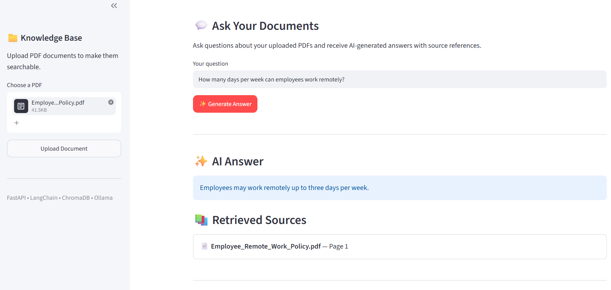

# 🧠 DocuMind AI — Intelligent Document Assistant

A containerized Retrieval-Augmented Generation (RAG) application that allows users to upload PDF documents and ask questions about their content using a locally hosted Large Language Model.

## Features

- **PDF Upload:** Upload documents through an interactive Streamlit interface.
- **Automatic Indexing:** Extract, split, and embed document content.
- **Semantic Search:** Retrieve relevant passages using ChromaDB.
- **AI-Powered Answers:** Generate contextual answers using Ollama and Llama 3.2.
- **Source References:** Display source filenames and page numbers.
- **Persistent Storage:** Preserve indexed documents across container restarts.
- **Duplicate Detection:** Detect exact duplicate uploads using SHA-256 hashes.
- **Dockerized Deployment:** Run the frontend and backend using Docker Compose.

## Technology Stack

| Component | Technology |
|---|---|
| Frontend | Streamlit |
| Backend | Python, FastAPI |
| LLM | Llama 3.2 via Ollama |
| Embeddings | nomic-embed-text |
| RAG Framework | LangChain |
| Vector Database | ChromaDB |
| Containerization | Docker, Docker Compose |

## System Architecture

```text
                  User
                   |
             Streamlit UI
                   |
                FastAPI
                /     \
        PDF Upload    Question
             |           |
       PDF Extraction    |
             |           |
       Text Chunking     |
             |           |
       Ollama Embeddings |
             |           |
             v           v
                ChromaDB
                   |
             Retrieved Chunks
                   |
             Prompt + Context
                   |
            Ollama (Llama 3.2)
                   |
              AI Answer
                   |
          Answer + Source References
```

## Getting Started

### Prerequisites

- Docker Desktop
- Ollama installed and running on the host machine
- Ollama models `llama3.2:3b` and `nomic-embed-text`

### 1. Clone the Repository

```bash
git clone https://github.com/YOUR_USERNAME/DocuMind-AI.git
cd DocuMind-AI
```

Replace `YOUR_USERNAME` with your GitHub username.

### 2. Download the Ollama Models

```bash
ollama pull llama3.2:3b
ollama pull nomic-embed-text
```

### 3. Configure Environment Variables

```bash
cp .env.example .env
```

On Windows PowerShell, use:

```powershell
Copy-Item .env.example .env
```

### 4. Start the Application

```bash
docker compose up --build
```

Open the Streamlit interface at:

http://localhost:8501

FastAPI documentation is available at:

http://localhost:8000/docs

Make sure Ollama is running on your host machine before submitting questions or uploading documents.

## Example Usage

1. Upload the sample employee remote-work policy PDF.
2. Wait until the document is indexed.
3. Ask: "How many days per week can employees work remotely?"
4. Review the AI-generated answer and retrieved source references.

## Project Screenshot



## Future Improvements

- Document management and deletion
- Improved retrieval relevance and reranking
- RAG evaluation metrics
- Conversation history
- Cloud deployment

## Author

M.Sc. Artificial Intelligence graduate with experience in computer vision, deep learning, and API development, expanding into Generative AI, RAG systems, and AI application engineering.
